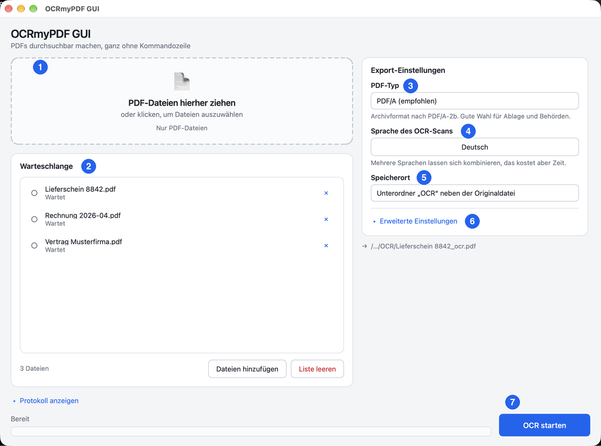
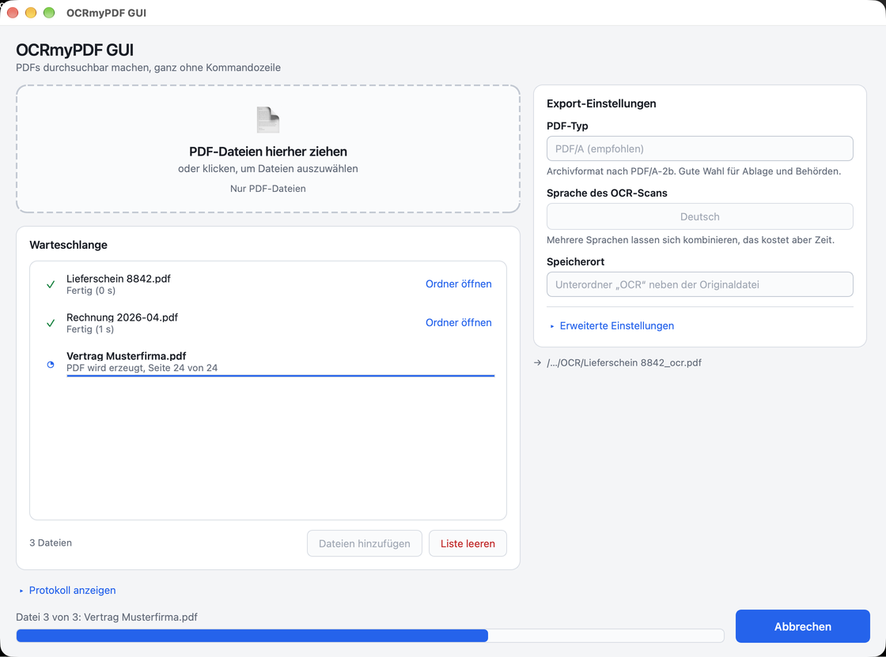
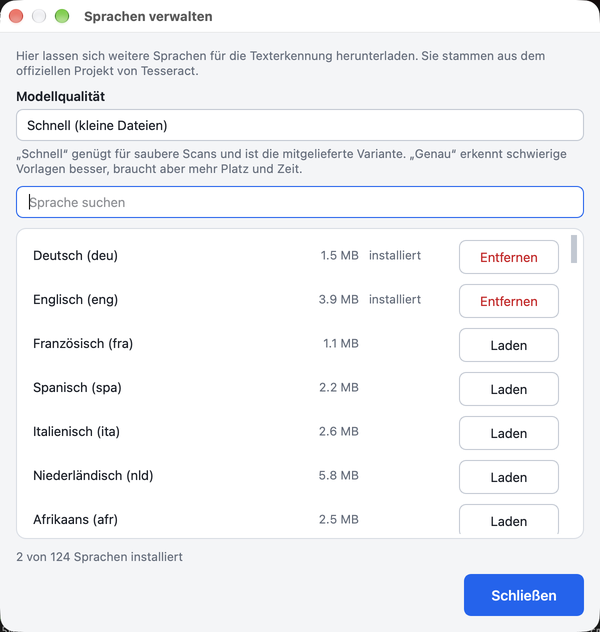
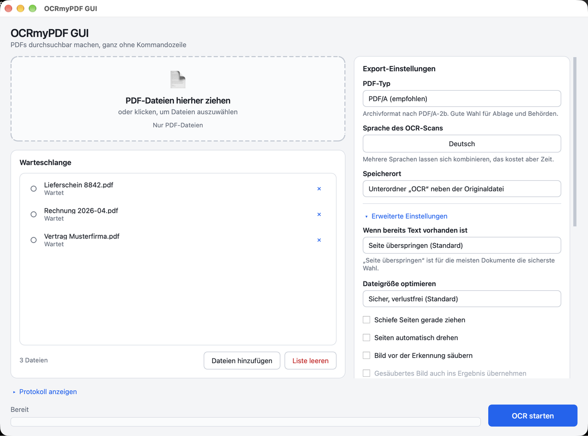

# OCRmyPDF GUI

Eine einfach zu bedienende Oberfläche für [OCRmyPDF](https://ocrmypdf.readthedocs.io/)
und [Tesseract](https://tesseract-ocr.github.io/). Sie macht eingescannte PDF-Dateien
durchsuchbar, per Doppelklick gestartet und ganz ohne Kommandozeile.



**Was die Anwendung kann**

- PDF-Dateien per Ziehen-und-Ablegen oder über den Dateidialog einlesen (nur PDF)
- Mehrere Dateien nacheinander abarbeiten, mit Fortschrittsanzeige je Seite
- Ausgabe als PDF, PDF/A, PDF/A-1b, PDF/A-2b oder PDF/A-3b
- Texterkennung in Deutsch und Englisch ab Werk, rund 120 weitere Sprachen
  direkt in der Anwendung nachladbar, auch mehrere gleichzeitig
- Speichern in einen festen Ordner oder in einen Unterordner neben dem Original
- Oberfläche auf Deutsch und Englisch
- Originaldateien bleiben unverändert

---

## Inhalt

1. [Schnellstart](#1-schnellstart)
2. [Das Fenster im Überblick](#2-das-fenster-im-überblick)
3. [Installation im Detail](#3-installation-im-detail)
4. [Erste Schritte](#4-erste-schritte)
5. [Die Einstellungen im Einzelnen](#5-die-einstellungen-im-einzelnen)
6. [Konfiguration](#6-konfiguration)
7. [Wenn etwas nicht klappt](#7-wenn-etwas-nicht-klappt)
8. [Aus dem Quellcode bauen](#8-aus-dem-quellcode-bauen)
9. [Aufbau des Projekts](#9-aufbau-des-projekts)
10. [Lizenz](#10-lizenz)

---

## 1. Schnellstart

Dieser Abschnitt setzt voraus, dass Sie die fertige Anwendung aus den
[Releases](https://codeberg.org/nabu-jena/OCRmyPDF-GUI/releases) heruntergeladen
haben. Sie brauchen weder Python noch sonst eine Vorinstallation.

### macOS

1. `OCRmyPDF-GUI.dmg` doppelklicken.
2. Das Symbol **OCRmyPDF GUI** in den Ordner **Programme** ziehen.
3. Im Ordner **Programme** mit der **rechten Maustaste** auf die App klicken,
   **Öffnen** wählen und die Rückfrage bestätigen.
   Dieser eine Umweg ist nötig, weil die App nicht bei Apple registriert ist.
   Ab dem zweiten Mal genügt ein Doppelklick.

### Windows

1. `OCRmyPDF-GUI-Setup.exe` ausführen und dem Assistenten folgen.
2. Meldet SmartScreen „Der Computer wurde durch Windows geschützt“, auf
   **Weitere Informationen** und dann **Trotzdem ausführen** klicken.
3. Die Anwendung über das Startmenü öffnen.

Wer nichts installieren möchte, nimmt stattdessen das ZIP-Archiv, entpackt es an
einen beliebigen Ort und startet darin `OCRmyPDF GUI.exe`.

### Linux

1. Die Datei `OCRmyPDF-GUI-x86_64.AppImage` herunterladen.
2. Einmalig ausführbar machen, entweder im Dateimanager über
   *Eigenschaften → Zugriffsrechte → Ausführen erlauben* oder im Terminal mit
   `chmod +x OCRmyPDF-GUI-x86_64.AppImage`.
3. Per Doppelklick starten.

Alternativ gibt es ein `.tar.gz`. Es wird an einen beliebigen Ort entpackt und
darin `ocrmypdf-gui` gestartet.

### In drei Schritten zur durchsuchbaren PDF

1. **Dateien hineinziehen.** PDF-Dateien auf die gestrichelte Fläche ziehen oder
   daraufklicken, um sie auszuwählen.
2. **Sprache prüfen.** Rechts unter *Sprache des OCR-Scans* muss die Sprache des
   Dokuments stehen. Das ist die einzige Einstellung, die wirklich zählt.
   Mitgeliefert sind Deutsch und Englisch; weitere Sprachen lassen sich
   [nachinstallieren](#sprache-des-ocr-scans).
3. **Auf „OCR starten“ klicken.** Die fertigen Dateien landen in einem
   Unterordner `OCR` neben den Originalen. Die Originale bleiben unberührt.

Alles Weitere, insbesondere PDF-Typ und Speicherort, ist bereits sinnvoll
voreingestellt.

> **Hinweis:** Wenn beim ersten Start ein Fenster **Einrichtung** erscheint,
> fehlt ein Hilfsprogramm. Das passiert nur bei der schlanken Paketvariante.
> Der Dialog nennt den Installationsbefehl zum Kopieren und verlinkt die
> Downloadseite; danach auf *Erneut prüfen* klicken. Einzelheiten stehen unter
> [Installation im Detail](#3-installation-im-detail).

---

## 2. Das Fenster im Überblick

Alles Wichtige liegt in einem einzigen Fenster. Die Zahlen beziehen sich auf das
Bild oben.

| Nr. | Bereich | Wofür |
|:---:|---|---|
| **1** | **Ablagebereich** | PDF-Dateien hierher ziehen oder auf die Fläche klicken, um sie im Dateidialog auszuwählen. Andere Dateitypen werden abgelehnt. Ein ganzer Ordner lässt sich ebenfalls hineinziehen; die darin enthaltenen PDF-Dateien werden übernommen. |
| **2** | **Warteschlange** | Alle ausgewählten Dateien mit ihrem Zustand: *Wartet*, *Wird verarbeitet*, *Fertig* oder *Fehlgeschlagen*. Das ✕ am rechten Rand entfernt einen Eintrag wieder. |
| **3** | **PDF-Typ** | Das Format der fertigen Datei. *PDF/A (empfohlen)* ist die richtige Wahl für Ablage und Behörden. Unter dem Feld steht jeweils eine kurze Erklärung. |
| **4** | **Sprache des OCR-Scans** | Die wichtigste Einstellung für ein gutes Ergebnis. Ein Klick öffnet die Liste aller installierten Sprachen mit Suchfeld; mehrere lassen sich kombinieren. |
| **5** | **Speicherort** | Entweder ein Unterordner `OCR` neben der Originaldatei oder ein fester Zielordner. Darunter zeigt die Anwendung, wie der Pfad der ersten fertigen Datei lauten wird. |
| **6** | **Erweiterte Einstellungen** | Aufklappbar; hier liegen Bildverbesserung, Optimierung, Namenszusatz und weitere Optionen. Wer sie nicht braucht, lässt sie zu. |
| **7** | **OCR starten** | Startet die Verarbeitung. Während sie läuft, heißt die Schaltfläche *Abbrechen*. |

Ganz unten sitzen außerdem das aufklappbare **Protokoll** (nützlich, wenn eine
Datei nicht durchläuft) sowie die Fortschrittsanzeige über alle Dateien.

### Während der Verarbeitung



Jede Datei zeigt ihren eigenen Fortschritt mitsamt aktueller Seite und
Arbeitsschritt (*Text wird erkannt*, *Textebene wird eingefügt*, *PDF wird
erzeugt*, *Datei wird optimiert*). Fertige Dateien bekommen einen grünen Haken
und einen Verweis **Ordner öffnen**. Der Balken ganz unten zeigt den Fortschritt
über alle Dateien.

---

## 3. Installation im Detail

Die Schritt-für-Schritt-Anleitung steht im [Schnellstart](#1-schnellstart).
Dieser Abschnitt erklärt, was dabei im Hintergrund passiert.

### Wohin die Anwendung installiert wird

| System | Ort | Entfernen |
|---|---|---|
| macOS | `/Programme/OCRmyPDF GUI.app` | App in den Papierkorb ziehen |
| Windows (Setup) | `C:\Program Files\OCRmyPDF GUI` | *Einstellungen → Apps → OCRmyPDF GUI* |
| Windows (ZIP) | beliebiger Ordner | Ordner löschen |
| Linux (AppImage) | beliebiger Ordner | Datei löschen |
| Linux (tar.gz) | beliebiger Ordner | Ordner löschen |

Die Einstellungen liegen getrennt davon im Benutzerprofil, siehe
[Konfiguration](#6-konfiguration). Beim Entfernen der Anwendung bleiben sie
erhalten; wer auch sie loswerden will, löscht die dort genannte Datei.

### Download auf Unversehrtheit prüfen

Zu jedem Build gehört eine Datei `sha.txt` mit den SHA-256-Prüfsummen. Damit
lässt sich feststellen, ob eine heruntergeladene Datei vollständig und
unverändert ist:

```bash
# macOS und Linux, im Ordner mit der Datei und sha.txt
shasum -a 256 -c sha.txt
```

```powershell
# Windows
Get-FileHash .\OCRmyPDF-GUI-Setup.exe -Algorithm SHA256
```

Erwartet wird die Ausgabe `OK` beziehungsweise ein Wert, der mit dem Eintrag in
`sha.txt` übereinstimmt. Das Programmbündel `OCRmyPDF GUI.app` ist ein Ordner
und lässt sich nicht als einzelne Datei prüfen; sein Wert steht in `sha.txt` als
Kommentar und wird mit `python tools/make_checksums.py` nachgerechnet.

### Warum die Sicherheitswarnungen erscheinen

Die Pakete sind nicht bei Apple beziehungsweise Microsoft signiert, weil dafür
kostenpflichtige Entwicklerzertifikate nötig wären. Betriebssysteme warnen
deshalb bei unbekannter Herkunft. Der Weg daran vorbei steht im Schnellstart.
Wenn Sie sichergehen wollen, bauen Sie die Anwendung nach
[Abschnitt 8](#8-aus-dem-quellcode-bauen) selbst aus dem Quellcode.

### Werden weitere Programme benötigt?

Nein, sofern Sie ein Paket verwenden, das mit der Option `--vendor` gebaut wurde.
Darin sind Tesseract und Ghostscript bereits enthalten. Die Releases sind so
gebaut.

Falls doch etwas fehlt, zeigt die Anwendung beim Start einen
**Einrichtungsdialog**. Dieser benennt das fehlende Programm, zeigt den
passenden Installationsbefehl zum Kopieren und verlinkt die Downloadseite. Nach
der Installation genügt ein Klick auf **Erneut prüfen**.

| Programm | Wofür | macOS | Windows |
|---|---|---|---|
| Tesseract | erkennt den Text | `brew install tesseract tesseract-lang` | `winget install -e --id UB-Mannheim.TesseractOCR` |
| Ghostscript | erzeugt die PDF/A-Datei | `brew install ghostscript` | `winget install -e --id ArtifexSoftware.GhostScript` |
| pngquant, jbig2enc *(optional)* | starke Größenoptimierung | `brew install pngquant jbig2enc` | in den Tesseract-Paketen nicht enthalten |

Fehlen die beiden optionalen Programme, sind in den erweiterten Einstellungen
lediglich die Optimierungsstufen *Stark* und *Maximal* gesperrt. Alles andere
funktioniert normal.

---

## 4. Erste Schritte

1. **Dateien auswählen.** PDF-Dateien in die gestrichelte Fläche ziehen oder
   auf die Fläche klicken, um sie im Dateidialog auszuwählen. Auch ein ganzer
   Ordner lässt sich hineinziehen; die darin enthaltenen PDF-Dateien werden
   übernommen. Andere Dateitypen werden abgelehnt.
2. **Sprache prüfen.** Unter *Sprache des OCR-Scans* die Sprache(n) des
   Dokuments wählen. Das ist die wichtigste Einstellung für ein gutes Ergebnis.
3. **Speicherort festlegen.** Standardmäßig landet das Ergebnis in einem
   Unterordner `OCR` neben der Originaldatei. Alternativ lässt sich ein fester
   Ordner wählen.
4. **Auf „OCR starten“ klicken.** Der Fortschritt ist je Datei und je Seite
   sichtbar. Ein Klick auf dieselbe Schaltfläche bricht den Vorgang ab.
5. **Ergebnis öffnen.** Neben jeder fertigen Datei erscheint *Ordner öffnen*.

Die Originaldateien werden dabei nie verändert oder gelöscht.

---

## 5. Die Einstellungen im Einzelnen

### PDF-Typ

| Auswahl | Bedeutung |
|---|---|
| **PDF (Standard)** | Normale PDF-Datei. Die kleinsten Dateien, für den täglichen Gebrauch. |
| **PDF/A (empfohlen)** | Archivformat (entspricht PDF/A-2b). Gute Wahl für Ablage, Buchhaltung und Behörden. |
| **PDF/A-1b** | Ältester Archivstandard. Nur wählen, wenn eine Stelle ihn ausdrücklich verlangt. |
| **PDF/A-2b** | Wie PDF/A, aber ausdrücklich benannt. Bessere Komprimierung als PDF/A-1b. |
| **PDF/A-3b** | Wie PDF/A-2b, erlaubt zusätzlich eingebettete Dateien, etwa für ZUGFeRD-Rechnungen. |

PDF/A-Dateien sind etwas größer als normale PDF-Dateien, weil alle Schriften
eingebettet werden. Dafür sind sie langfristig zuverlässig lesbar.

### Sprache des OCR-Scans

Ein Klick öffnet eine Liste aller installierten Sprachpakete mit Suchfeld.
Mehrere Sprachen lassen sich kombinieren (z. B. Deutsch **und** Englisch für
Dokumente mit englischen Fachbegriffen). Jede zusätzliche Sprache verlängert
die Verarbeitung spürbar; mehr als zwei sind selten sinnvoll.

**Weitere Sprachen nachladen**

Die fertigen Pakete bringen Deutsch und Englisch mit. Über *Weitere Sprachen
laden ...* in der Sprachauswahl holt die Anwendung jede der rund 120 weiteren
Sprachen direkt aus dem offiziellen Projekt von Tesseract. Eine Installation
von Hand oder über die Kommandozeile ist nicht nötig.



Bei der **Modellqualität** stehen zwei Varianten zur Wahl:

| | Größe je Sprache | Wofür |
|---|---|---|
| **Schnell** | 1 bis 4 MB | Die mitgelieferte Variante. Für saubere Scans ab 300 dpi völlig ausreichend und deutlich schneller. |
| **Genau** | 4 bis 15 MB | Erkennt schwierige Vorlagen besser, etwa schwachen Kontrast oder ungewöhnliche Schriften. Braucht mehr Zeit und Platz. |

Heruntergeladene Sprachen stehen sofort zur Auswahl. Über *Entfernen* lassen
sie sich wieder löschen; mindestens eine Sprache bleibt immer erhalten.

Die Dateien landen im Benutzerprofil, nicht im Programmordner:

| System | Ort |
|---|---|
| macOS | `~/Library/Application Support/OCRmyPDF-GUI/tessdata` |
| Windows | `%APPDATA%\OCRmyPDF-GUI\tessdata` |
| Linux | `~/.config/OCRmyPDF-GUI/tessdata` |

Beim ersten Download übernimmt die Anwendung die mitgelieferten Sprachen
dorthin, denn der Ordner im Programmpaket ist schreibgeschützt. Eine
Neuinstallation der Anwendung lässt die nachgeladenen Sprachen unberührt.

### Speicherort

- **Unterordner „OCR“ neben der Originaldatei:** praktisch, wenn die Dateien
  aus verschiedenen Ordnern stammen. Jeder Ordner bekommt sein eigenes `OCR`.
- **Fester Ordner:** alle Ergebnisse landen an einer Stelle.

Der Ordner wird bei Bedarf automatisch angelegt.

### Erweiterte Einstellungen



Ein Klick auf *Erweiterte Einstellungen* klappt diesen Bereich auf. Für den
Normalfall müssen Sie hier nichts ändern.

| Einstellung | Bedeutung |
|---|---|
| **Wenn bereits Text vorhanden ist** | *Seite überspringen* (Standard) lässt Seiten mit vorhandenem Text unangetastet, das ist die sicherste Wahl. *Vorhandene Texterkennung erneuern* ersetzt eine frühere, schlechte Erkennung. *Alles neu erkennen* rastert auch echten Text zu Bildern; nur im Notfall verwenden. |
| **Dateigröße optimieren** | Standard ist *Sicher*, also verlustfreie Komprimierung ohne Zusatzprogramme. *Aus* übernimmt die Bilder unverändert. *Stark* und *Maximal* komprimieren verlustbehaftet und benötigen pngquant bzw. jbig2enc. |
| **Schiefe Seiten gerade ziehen** | Korrigiert schief eingescannte Seiten. Verbessert die Erkennung deutlich. |
| **Seiten automatisch drehen** | Erkennt auf dem Kopf stehende oder quer liegende Seiten und dreht sie. |
| **Bild vor der Erkennung säubern** | Entfernt Flecken und Linien, aber nur für die Erkennung; das sichtbare Bild bleibt unberührt. |
| **Gesäubertes Bild auch ins Ergebnis übernehmen** | Übernimmt das gesäuberte Bild in die fertige Datei. Nur zusammen mit der vorigen Option wählbar. |
| **Hintergrund entfernen** | Für Scans mit farbigem oder vergilbtem Hintergrund. Bei Fotos und Grafiken besser abschalten. |
| **Erkannten Text als .txt speichern** | Legt den reinen Text zusätzlich als Textdatei neben der PDF ab. |
| **Vorhandene Dateien überschreiben** | Ist die Option aus, wird an gleichnamige Dateien `(2)`, `(3)` usw. angehängt, statt etwas zu überschreiben. |
| **Namenszusatz** | Wird an den Dateinamen angehängt, Standard `_ocr`. |
| **Parallele Prozesse je Datei** | *Automatisch* nutzt alle Prozessorkerne. Ein kleinerer Wert schont den Rechner. |
| **Auflösung für Bilder ohne DPI-Angabe** | Nur nötig, wenn eine Datei keine Auflösungsangabe enthält und die Verarbeitung deshalb abbricht. Üblich sind 300. |
| **Zeitlimit je Seite** | Bricht besonders schwierige Seiten nach der angegebenen Zeit ab, statt endlos zu rechnen. |
| **Sprache der Oberfläche** | Deutsch oder Englisch, sofort wirksam. |

---

## 6. Konfiguration

Alle Einstellungen werden automatisch gespeichert und beim nächsten Start
wiederhergestellt. Die Datei liegt hier:

| System | Pfad |
|---|---|
| macOS | `~/Library/Application Support/OCRmyPDF-GUI/settings.json` |
| Windows | `%APPDATA%\OCRmyPDF-GUI\settings.json` |
| Linux | `~/.config/OCRmyPDF-GUI/settings.json` |

Es ist eine einfache JSON-Datei, die sich bei Bedarf mit einem Texteditor
bearbeiten lässt:

```json
{
  "pdf_type": "pdfa",
  "languages": ["deu", "eng"],
  "output_mode": "subfolder",
  "output_folder": null,
  "ocr_mode": "skip-text",
  "optimize_level": 1,
  "deskew": false,
  "filename_suffix": "_ocr",
  "ui_language": "de"
}
```

Wird die Datei gelöscht, startet die Anwendung wieder mit den Standardwerten.
Dasselbe erreicht die Schaltfläche **Auf Standard zurücksetzen** in den
erweiterten Einstellungen.

### Eigene Programmpfade erzwingen

Setzen Sie vor dem Start eine dieser Umgebungsvariablen, um eine bestimmte
Installation zu verwenden:

- `TESSDATA_PREFIX`: Ordner mit den Tesseract-Sprachdateien
- `PATH`: die Anwendung durchsucht zusätzlich die üblichen Installationsorte

Die Suchreihenfolge ist: mitgelieferte Binaries → `PATH` → übliche
Installationsorte des Betriebssystems.

---

## 7. Wenn etwas nicht klappt

**Die Anwendung startet nicht (macOS).**
Rechtsklick auf das Symbol → *Öffnen* → Nachfrage bestätigen. Siehe
[Installation](#macos).

**„Ein benötigtes Hilfsprogramm fehlt“.**
Tesseract oder Ghostscript wurde nicht gefunden. Der Einrichtungsdialog nennt
den Installationsbefehl. Nach der Installation auf *Erneut prüfen* klicken.

**Eine bereits durchsuchbare PDF wird scheinbar nicht bearbeitet.**
Mit der Standardeinstellung *Seite überspringen* lässt die Anwendung Seiten,
die schon Text enthalten, unangetastet. Die Datei wird trotzdem geschrieben
und im gewählten PDF-Typ gespeichert. Soll die Erkennung erneuert werden:
erweiterte Einstellungen → *Wenn bereits Text vorhanden ist* →
*Vorhandene Texterkennung erneuern*.

**„Das Ergebnis entspricht nicht dem gewählten PDF/A-Standard.“**
Manche Dateien lassen sich nicht in PDF/A überführen, etwa wegen defekter
eingebetteter Schriften. Als PDF-Typ *PDF (Standard)* wählen.

**„Die PDF-Datei ist passwortgeschützt.“**
Der Schutz muss zuerst entfernt werden; OCRmyPDF kann verschlüsselte Dateien
nicht verarbeiten.

**Die Erkennung ist schlecht.**
Prüfen Sie zuerst die eingestellte Sprache. Danach hilft meist
*Schiefe Seiten gerade ziehen*. Scans unter 200 dpi sind für eine zuverlässige
Erkennung grundsätzlich zu grob.

**Die Verarbeitung dauert sehr lange.**
Das ist bei vielen Seiten normal. Als grobe Faustregel für einen Buchscan mit
300 dpi: etwa eine Sekunde pro Seite und Prozessorkern, bei dichten Vorlagen
auch deutlich mehr. Weniger Sprachen und eine niedrige Optimierungsstufe
beschleunigen die Sache.

**Eine Sprache fehlt in der Liste.**
Die fertigen Pakete enthalten nur Deutsch und Englisch. Alle weiteren Sprachen
laden Sie direkt in der Anwendung nach: Sprachauswahl öffnen, dann *Weitere
Sprachen laden ...*. Dafür wird einmalig eine Internetverbindung gebraucht.

**„Keine Verbindung zum Server" beim Nachladen von Sprachen.**
Die Sprachdateien kommen über HTTPS von `raw.githubusercontent.com`. In
Firmennetzen blockiert das gelegentlich eine Firewall oder ein Proxy. Als
Ausweichweg lassen sich die Dateien von Hand in den oben genannten
`tessdata`-Ordner legen.

**Die Anwendung startet unter Linux nicht und meldet etwas zu `xcb`.**
Qt 6 braucht eine Systembibliothek, die auf schlanken Installationen fehlt:

```bash
sudo apt install libxcb-cursor0
```

**Genaue Fehlerursache finden.**
*Protokoll anzeigen* aufklappen, *Alle Details anzeigen* ankreuzen und das
Protokoll bei Bedarf über *Protokoll speichern* sichern.

---

## 8. Aus dem Quellcode bauen

### Voraussetzungen

- Python 3.10 oder neuer
- macOS: [Homebrew](https://brew.sh/); Windows: [winget](https://learn.microsoft.com/windows/package-manager/)

### Im Entwicklungsmodus starten

```bash
git clone <repository-url>
cd OCRmyPDF-GUI

python3 -m venv .venv
source .venv/bin/activate          # Windows: .venv\Scripts\activate
pip install -r requirements.txt

python main.py
```

### macOS: `.app` und `.dmg` bauen

```bash
# Hilfsprogramme installieren, damit sie mitgeliefert werden können
brew install tesseract tesseract-lang ghostscript pngquant jbig2enc

./packaging/build_macos.sh --vendor --dmg
```

Ergebnis: `dist/OCRmyPDF GUI.app` und `dist/OCRmyPDF-GUI.dmg`.

| Option | Wirkung |
|---|---|
| *(ohne)* | Schlankes Paket (172 MB). Tesseract und Ghostscript müssen auf dem Zielrechner installiert sein. |
| `--vendor` | Liefert Tesseract, Ghostscript, pngquant und jbig2enc mit (198 MB, DMG 91 MB). Die App läuft ohne Vorinstallation. |
| `--dmg` | Erzeugt zusätzlich ein DMG mit Verknüpfung zum Programme-Ordner. |

### Windows: `.exe` und Installationsprogramm bauen

```powershell
winget install -e --id UB-Mannheim.TesseractOCR
winget install -e --id ArtifexSoftware.GhostScript
winget install -e --id JRSoftware.InnoSetup    # nur für das Installationsprogramm

.\packaging\build_windows.ps1 -Vendor -Installer
```

Ergebnis: `dist\OCRmyPDF GUI\OCRmyPDF GUI.exe` und `dist\OCRmyPDF-GUI-Setup.exe`.

`-Vendor` liefert unter Windows nur Tesseract und Ghostscript mit; pngquant
und jbig2enc gibt es dort nicht als fertige Pakete. Die Optimierungsstufen
*Stark* und *Maximal* bleiben dann gesperrt, alles Übrige funktioniert.

### Linux: AppImage und Archiv bauen

```bash
sudo apt install tesseract-ocr tesseract-ocr-deu ghostscript patchelf
sudo apt install pngquant          # optional, für starke Größenoptimierung

./packaging/build_linux.sh --vendor --appimage
```

Ergebnis: `dist/ocrmypdf-gui/` als Programmordner,
`dist/OCRmyPDF-GUI-linux-x86_64.tar.gz` und
`dist/OCRmyPDF-GUI-x86_64.AppImage`.

Für die AppImage wird `appimagetool` gebraucht. Fehlt es, nennt das Skript den
Bezugsweg und baut nur das Archiv:

```bash
wget -O ~/.local/bin/appimagetool \
  https://github.com/AppImage/appimagetool/releases/download/continuous/appimagetool-x86_64.AppImage
chmod +x ~/.local/bin/appimagetool
```

> **Zur Verträglichkeit:** Mitgelieferte Bibliotheken werden gegen die glibc des
> Build-Rechners gebaut. Ein auf Ubuntu 24.04 erzeugtes Paket läuft deshalb
> nicht zwangsläufig auf älteren Distributionen. Wer breit verteilen möchte,
> baut auf einer möglichst alten Distribution oder lässt `--vendor` weg und
> überlässt Tesseract und Ghostscript der Paketverwaltung.

### Paketgröße steuern

Den größten Anteil haben die Sprachdateien von Tesseract. Voreingestellt sind
deshalb nur Deutsch und Englisch, damit das DMG unter den 100 MB bleibt, die
Codeberg je Release-Datei zulässt:

```bash
python tools/vendor_macos.py                        # Deutsch + Englisch  (39 MB)
python tools/vendor_macos.py --languages european   # 26 europäische     (116 MB)
python tools/vendor_macos.py --languages all        # alle installierten (363 MB)
python tools/vendor_macos.py --languages deu,eng,fra,ita   # eigene Auswahl
```

Unter Windows und Linux gilt dasselbe für `tools\vendor_windows.py`
beziehungsweise `tools/vendor_linux.py`.

### Signierung

Die Build-Skripte signieren nur *ad hoc*. Für eine Weitergabe ohne
Sicherheitswarnungen ist eine echte Signatur nötig:

- **macOS:** Developer-ID-Zertifikat, anschließend `codesign` und `notarytool`
  zur Beglaubigung bei Apple.
- **Windows:** Code-Signing-Zertifikat und `signtool`.

---

## 9. Aufbau des Projekts

```
OCRmyPDF-GUI/
├── main.py                     Startskript (auch Einstiegspunkt für PyInstaller)
├── ocrmypdf_gui/
│   ├── app.py                  Programmstart; enthält auch den OCR-Arbeitermodus
│   ├── config.py               Einstellungen laden und speichern
│   ├── dependencies.py         Tesseract/Ghostscript finden, Umgebung aufbauen
│   ├── i18n.py                 Übersetzungen Deutsch/Englisch
│   ├── languages.py            Klartextnamen der Tesseract-Sprachcodes
│   ├── models.py               Einstellungen, Aufträge, Kommandozeilenaufbau
│   ├── runner.py               Hintergrund-Thread, der OCRmyPDF ausführt
│   ├── tessdata.py             Sprachdateien verwalten und nachladen
│   └── ui/
│       ├── main_window.py      Hauptfenster
│       ├── drop_area.py        Ablagebereich für PDF-Dateien
│       ├── file_list.py        Warteschlange mit Zustand je Datei
│       ├── settings_panel.py   Grund- und erweiterte Einstellungen
│       ├── language_dialog.py  Sprachauswahl mit Suche
│       ├── download_dialog.py  Sprachen nachladen
│       ├── setup_dialog.py     Einrichtungshilfe bei fehlenden Programmen
│       ├── widgets.py          Wiederverwendbare Bausteine
│       └── style.py            Farben und Stylesheet (hell und dunkel)
├── packaging/
│   ├── ocrmypdf_gui.spec       PyInstaller-Beschreibung
│   ├── build_macos.sh          Build-Skript für macOS
│   ├── build_windows.ps1       Build-Skript für Windows
│   ├── build_linux.sh          Build-Skript für Linux
│   ├── ocrmypdf-gui.desktop    Menüeintrag für Linux
│   └── installer.iss           Inno-Setup-Beschreibung
├── tools/
│   ├── make_icons.py           erzeugt icon.png/.icns/.ico
│   ├── make_checksums.py       schreibt dist/sha.txt
│   ├── vendor_macos.py         bündelt Tesseract & Co. für macOS
│   ├── vendor_windows.py       bündelt Tesseract & Co. für Windows
│   └── vendor_linux.py         bündelt Tesseract & Co. für Linux
└── vendor/                     Ablage der mitgelieferten Binaries
```

**Wie die Verarbeitung abläuft:** Die Oberfläche startet OCRmyPDF bewusst als
eigenen Prozess (`runner.py`). Dadurch bleibt das Fenster jederzeit bedienbar,
ein Abbruch ist sauber möglich, und ein Fehler in der Verarbeitung reißt die
Anwendung nicht mit. Im gebündelten Programm ruft sich die Anwendung dafür
selbst mit dem Schalter `--ocr-worker` auf. Eine separate
OCRmyPDF-Installation ist deshalb nicht nötig.

**Konventionen:** Der Code ist durchgehend englisch, die Kommentare sind
deutsch. Oberflächentexte stehen ausschließlich in `i18n.py`.

---

## 10. Lizenz

Dieses Projekt steht unter der MIT-Lizenz, siehe [LICENSE](LICENSE).

Die mitgelieferten Programme haben eigene Lizenzen. Zu beachten ist vor allem
**Ghostscript (AGPL v3)**: Wer die Anwendung mit mitgeliefertem Ghostscript
weitergibt, unterliegt den Bedingungen der AGPL. Für eine kommerzielle
Weitergabe ohne AGPL-Pflichten bietet Artifex eine kostenpflichtige Lizenz an.
